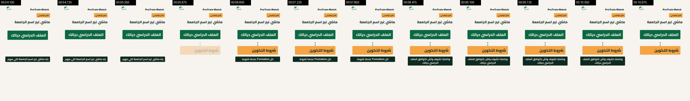
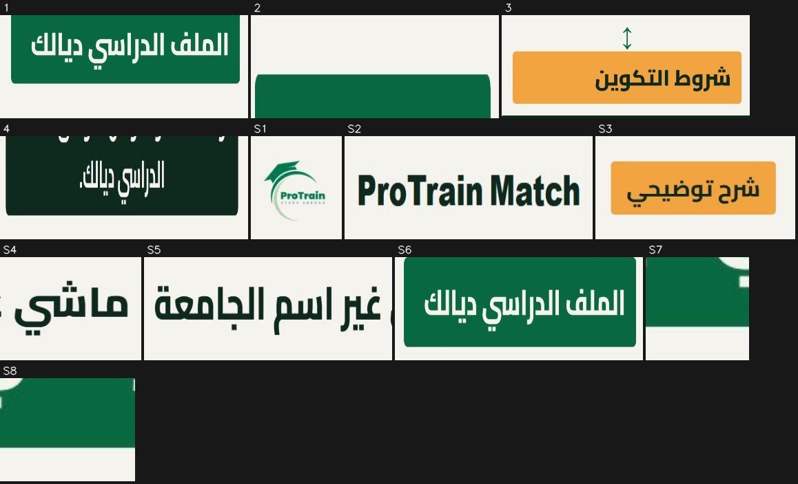
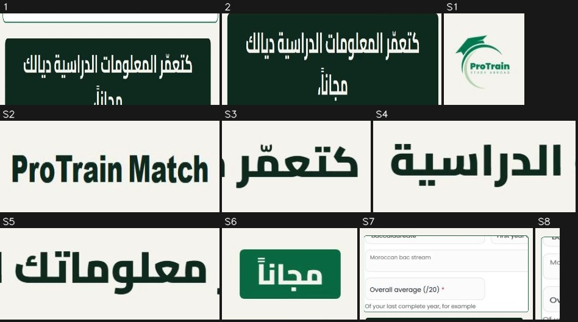
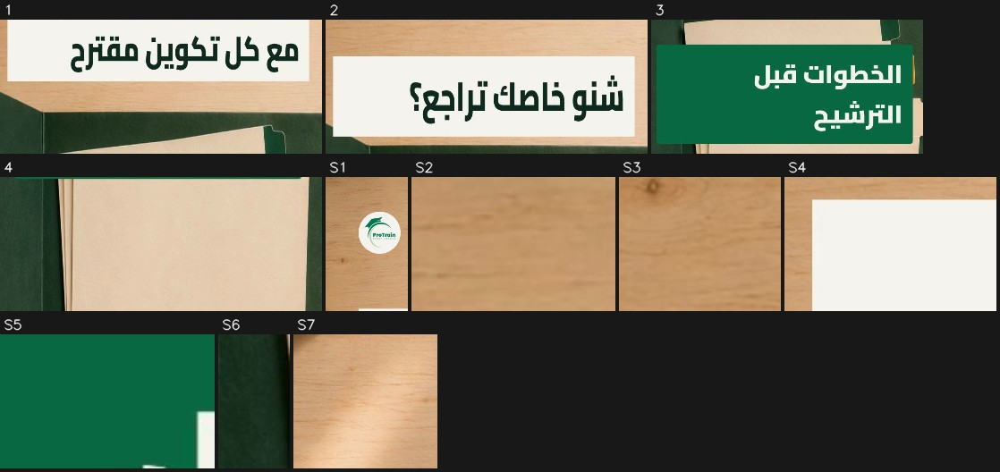
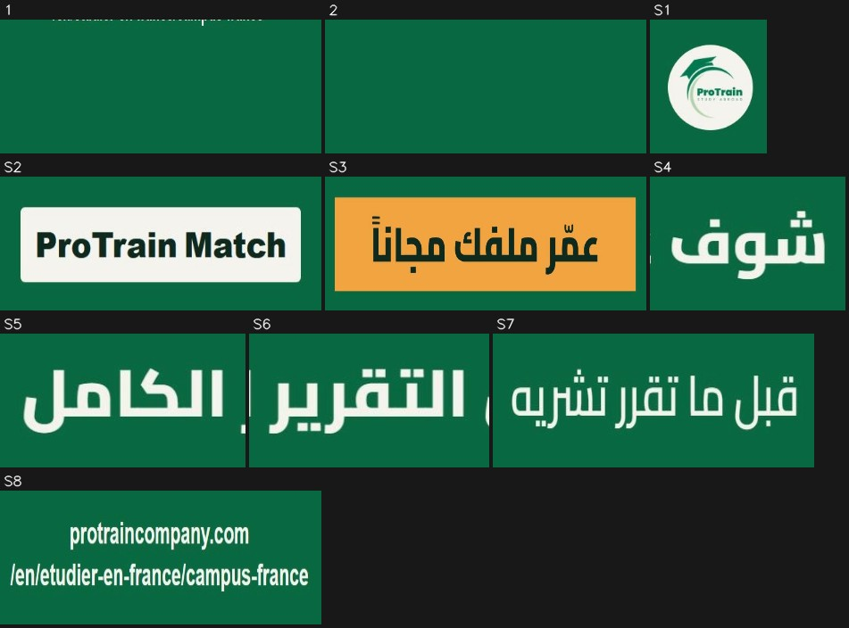
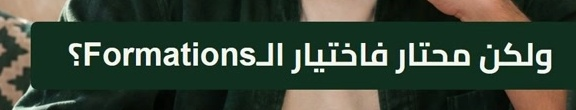
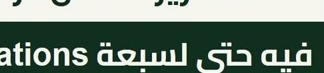
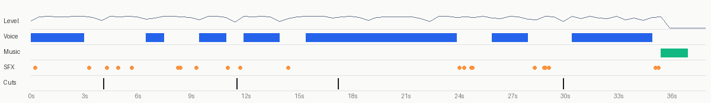
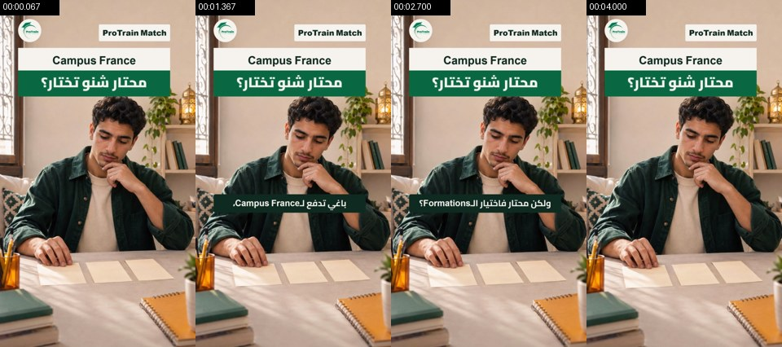

# How this video was made: ptm-p001-preview-v2.mp4

**How it was made**: Mixed production: code / template render 89% + AI-generated video 11%

- 0:38 · vertical 9:16 · 5 shots, 7.6s each on average
- Confidence 70%, based on: tool measurements
- ⚠️ 4 points are uncertain, see “Open questions”

<!--mix-->


## At a glance: picture, packaging, sound

Any short video splits into three layers: the picture, what is laid on top of it (subtitles, styled text, stickers), and the sound. Remake it one layer at a time.

| Layer | In this video | How to make it | Detail |
|---|---|---|---|
| **Picture** (base) | code / template render 4 shots, AI-generated video 1 shot | AI in 1 generation; screen recording / motion graphics in code | “Remake it yourself” |
| **Packaging** (on top) | graphic, static sticker, animated sticker / GIF | add in the editor: subtitles, styled text and stickers by the timeline | “Packaging layer” |
| **Sound** | voice（TTS voice-over）, 21 sound effects | voice: TTS voice-over; effects: add from a library at the listed times | “Sound” |

## Content and structure

- The whole video's content was not analysed this time (needs AI image reading); subtitle text is under “Packaging layer”

- No narrative line this time (what each shot is doing in the story needs AI image reading); the “Picture” column of the shot list is a start

## Shot list

Picture, Camera and Overlays are what is visible on screen; Made with and Material are the tools' inference, with the basis in the shot-by-shot appendix.

| # | Frames | Time | Length | Picture | Camera | Overlays | Made with (inferred) | Material (inferred) | Remake |
|---|---|---|---|---|---|---|---|---|---|
| 1 |  | 0:00.0 | 4.1s | — | static | graphic, static sticker | AI-generated video 38% | AI-generated | AI generation · G1 |
| 2 |  | 0:04.1 | 7.5s | — | static | — | code / template render 82% | rendered by the creator | code render · Part 1 |
| 3 |  | 0:11.6 | 5.7s | — | static | animated sticker / GIF | code / template render 75% | rendered by the creator | code render · Part 1 |
| 4 |  | 0:17.3 | 12.7s | — | static | animated sticker / GIF | code / template render 58% | rendered by the creator | code render · Part 1 |
| 5 |  | 0:30.0 | 8.0s | — | static | — | code / template render 91% | rendered by the creator | code render · Part 1 |

## Remake it yourself: do it in this order

Copy the method and the rhythm, not the pictures.

1. **Plan the content**: go through the shot list, note what each part says, then write your own version
2. **Collect material**: see “What to prepare” below
3. **Generate**: 1 generation, see “AI generation” below
4. **Screen and motion graphics**: see “Code build” below
5. **Edit**: see “Edit” below
6. **Packaging**: the subtitle file `packaging/timeline.json` imports straight into an editor; styles and timeline under “Packaging layer”
7. **Sound**: see “Sound”; every effect can be played first
8. **Compare**: watch yours next to the original: shot lengths, subtitle positions, where the music comes in and drops

### What to prepare

- `@图片1` character reference images (one frontal face + one half-body per character) so the look stays consistent across shots

### AI generation

**1 AI video shot → 1 generation unit, 1 Seedance 2.0 call**

- Grouping: AI shots in the same scene joined by hard cuts are generated in one call; ≤15s per call; consecutive hard cuts inside a unit preferably ≤8s, at most 10s; split at dissolves / fades and scene changes
- Audio: the model can generate action sound effects and ambience along with the picture; voice-over is better done as separate TTS and mixed in, so copy and timing stay editable
- Packaging: the sticker on the generated shots is post-production packaging: keep it out of the prompts, erase it from reference frames, and lay it back on from the packaging timeline after generation
- The prompts below are written generically; before generating with Seedance 2.0, rewrite them the way it expects (timing and shots, how references are addressed, dialogue, exclusions): `rea-video models seedance-2.0`

A video model can take these inputs; each generation unit below lists which ones to feed and where they come from:
- **Text prompt**: always; describes the picture, action and camera
- **First frame**: locks the composition and subject of frame one. Without it this is plain text-to-video and framing changes every time
- **Last frame**: also locks the final frame so the model only fills in between. Suits a single shot with a camera move or action
- **Reference images**: how the product and people look, so they stay the same across shots (`@图片1` in the prompt)
- **Reference video**: copy the action, camera move and rhythm, not the picture (`@视频1`); not every model takes one

One generation per unit. The table lists what to feed the model; open a unit for where each input comes from and the prompt.

| Unit | Shots | Time | Duration | Mode | Feed | Continuity |
|---|---|---|---|---|---|---|
| G1 | #1 | 0.0–4.1s | 4.1s | single shot | first frame + reference image + reference video | — |

<details><summary>G1 · shots #1 · 4.1s · multi-reference generation</summary>

| Input | Needed | From | Why |
|---|---|---|---|
| text prompt | yes | see the prompt below | describes picture, action and camera; every other input only constrains it |
| first frame | worth it | source frame `shots/shot_001_first.jpg` (to change product, person or style, redraw it with an image model from the first-frame prompt below); this model takes frame inputs or references, not both: pass it as one more reference image and write “@图片2 as the first frame” in the prompt (Jimeng's omni-reference accepts this; most APIs do not, drop it if refused) | locks composition, shot size and subject position; with text alone every generation frames it differently |
| last frame | no | — | this unit uses references to keep the product and people; the model takes no last frame alongside them |
| reference image | yes | `@图片1` character reference images (one frontal face + one half-body per character) so the look stays consistent across shots | the first frame only fixes frame one; reference images keep the product and people consistent after it |
| reference video | worth it | `@视频1` source clip 0.0–4.1s | follow the action, camera move and cutting rhythm; reference only, the picture is not copied |

- Shots #1 have no prompt

```text
Vertical 9:16; backlit / background brighter than subject, hard light (sharp shadow edge), warm (about 3000–4000K), background sharp. Characters follow @图片1. Follow the action, camera movement and cutting rhythm of @视频1.
(prompt missing: run --vlm or have the agent write one from the frames)
```

</details>

### Code build

One Remotion / HTML project rebuilt from the text tracks and layout (text and UI are 100% controllable; changing copy is a data change). An LLM can write this project directly.

- Part 1: shots #2–#5 (4.1–38.0s)

Remake assets (all in the report folder; hand them over together with the data below to whoever writes the code, or to an LLM):
- `shots/shot_XXX_first.jpg` / `_last.jpg`: first / last frame of each shot at full size, for layout, type size and margins
- `shots/shot_XXX_strip.jpg`: key frames about every 0.5 s, to follow the animation
- `shots/shot_XXX_elements.jpg` and `_el_NN.jpg` / `_st_NN.jpg` / `_ly_NN.jpg`: full-size crop of every element once settled, numbered as in the motion timeline; redraw shapes from them, cut out icons, logos and illustrations that cannot be redrawn
- `packaging/overlays.ass`, `packaging/timeline.json`: timing, position and colour of the text

How to build the pictures (by the measured picture type):
- vector shapes: SVG shapes + interpolate() / spring() keyframes, positions and timing measured from the frame
- gradients / colour fields: CSS linear / radial gradients, or a few large circles with filter: blur() drifting slowly; glass cards with backdrop-filter

| Shot | Time | Build | Picture | Camera | Colours | On-screen text |
|---|---|---|---|---|---|---|
| #2 | 4.1–11.6s | vector shapes | (to fill from the images: what the elements form and how they move) | static | ground #f4f4ee · #f0a447 #0a6b47 #77a18e #4f5440 | — |
| #3 | 11.6–17.3s | vector shapes | (to fill from the images: what the elements form and how they move) | static | ground #f3f4f0 · #f9fbfe #102b22 #d5dcd8 #aab6b1 | — |
| #4 | 17.3–30.0s | vector shapes | (to fill from the images: what the elements form and how they move) | static | ground #e5c7a9 · #d5ad85 #2a402d #172e20 #096a46 | — |
| #5 | 30.0–38.0s | gradients / colour fields | (to fill from the images: what the elements form and how they move) | static | ground #0a6943 · #eea445 #77a893 #edf0eb #408568 | — |

Per-shot motion timeline (measured: positions in % of frame width / height, colours sampled once the element settles; read together with the key-frame strip)

<details class="ref"><summary>Motion #2 4.1–11.6s · 4 events</summary>



- Ground #f4f4ee; other main colours #f0a447 #0a6b47 #77a18e #4f5440
Element crops (numbers match the motion list below; L = the continuously moving layer mid-shot and at the end, S = elements that never move), full-size files in `shots/`:



- S1. never moves: shape / text block · x 11%–21%, y 6%–11% · #479379 · [crop](shots/shot_002_st_01.jpg)
- S2. never moves: shape / text block · x 52%–86%, y 8%–11% · #23322b · [crop](shots/shot_002_st_02.jpg)
- S3. never moves: shape / text block · x 63%–88%, y 12%–18% · #f2a440 · [crop](shots/shot_002_st_03.jpg)
- S4. never moves: shape / text block · x 70%–87%, y 20%–25% · #1c2e26 · [crop](shots/shot_002_st_04.jpg)
- S5. never moves: shape / text block · x 25%–69%, y 20%–24% · #1c3027 · [crop](shots/shot_002_st_05.jpg)
- S6. never moves: shape / text block · x 12%–84%, y 31%–39% · #086841 · [crop](shots/shot_002_st_06.jpg)
- S7. never moves: shape / text block · x 33%–38%, y 38%–39% · #086840 · [crop](shots/shot_002_st_07.jpg)
- S8. never moves: shape / text block · x 42%–49%, y 38%–39% · #086840 · [crop](shots/shot_002_st_08.jpg)
1. 4.17–4.63s · middle (x 11%–84%, y 32%–41%) · changes, linear · #ccdcd0 · [crop](shots/shot_002_el_01.jpg)
2. 4.50–4.63s · top (x 13%–84%, y 29%–30%) · appears, instant · #0d6642 · [crop](shots/shot_002_el_02.jpg)
3. 6.17–6.57s · middle (x 11%–84%, y 41%–55%) · appears, linear · #f2a440 · [crop](shots/shot_002_el_03.jpg)
4. 8.30–11.23s · middle (x 9%–89%, y 61%–65%) · disappears, ease-in-out · #cfd2ce · [crop](shots/shot_002_el_04.jpg)

</details>

<details class="ref"><summary>Motion #3 11.6–17.3s · 2 events</summary>


- Ground #f3f4f0; other main colours #f9fbfe #102b22 #d5dcd8 #aab6b1
Element crops (numbers match the motion list below; L = the continuously moving layer mid-shot and at the end, S = elements that never move), full-size files in `shots/`:



- S1. never moves: shape / text block · x 11%–21%, y 6%–11% · #469378 · [crop](shots/shot_003_st_01.jpg)
- S2. never moves: shape / text block · x 52%–86%, y 8%–11% · #23322b · [crop](shots/shot_003_st_02.jpg)
- S3. never moves: shape / text block · x 68%–87%, y 15%–20% · #132920 · [crop](shots/shot_003_st_03.jpg)
- S4. never moves: shape / text block · x 10%–36%, y 16%–20% · #132920 · [crop](shots/shot_003_st_04.jpg)
- S5. never moves: shape / text block · x 37%–67%, y 16%–20% · #132920 · [crop](shots/shot_003_st_05.jpg)
- S6. never moves: shape / text block · x 69%–88%, y 26%–31% · #096841 · [crop](shots/shot_003_st_06.jpg)
- S7. never moves: shape / text block · x 8%–91%, y 32%–55% · #ccdcd3 · [crop](shots/shot_003_st_07.jpg)
- S8. never moves: shape / text block · x 8%–13%, y 32%–51% · #b8c7bd · [crop](shots/shot_003_st_08.jpg)
- Continuous layer: 2% of the frame moves through the whole shot (x 9%–62%, y 32%–54%), e.g. drifting gradients, particle flow, breathing glow
1. 14.20–14.27s · middle (x 9%–89%, y 55%–61%) · appears, instant · #0f2a20 · [crop](shots/shot_003_el_01.jpg)
2. 17.27–17.33s · middle (x 9%–87%, y 57%–62%) · changes, instant · #ccd2cd · [crop](shots/shot_003_el_02.jpg)

</details>

<details class="ref"><summary>Motion #4 17.3–30.0s · 4 events</summary>


- Ground #e5c7a9; other main colours #d5ad85 #2a402d #172e20 #096a46
Element crops (numbers match the motion list below; L = the continuously moving layer mid-shot and at the end, S = elements that never move), full-size files in `shots/`:



- S1. never moves: shape / text block · x 0%–22%, y 0%–20% · #f1f1e6 · [crop](shots/shot_004_st_01.jpg)
- S2. never moves: shape / text block · x 25%–30%, y 0%–2% · #bd8f61 · [crop](shots/shot_004_st_02.jpg)
- S3. never moves: shape / text block · x 4%–10%, y 14%–16% · #c09262 · [crop](shots/shot_004_st_03.jpg)
- S4. never moves: shape / text block · x 8%–24%, y 21%–25% · #f6f3ee · [crop](shots/shot_004_st_04.jpg)
- S5. never moves: shape / text block · x 33%–42%, y 40%–41% · #086841 · [crop](shots/shot_004_st_05.jpg)
- S6. never moves: shape / text block · x 20%–22%, y 61%–64% · #1a301f · [crop](shots/shot_004_st_06.jpg)
- S7. never moves: shape / text block · x 9%–26%, y 91%–100% · #f2cca7 · [crop](shots/shot_004_st_07.jpg)
- In sequence: 3 same-size elements, 3.57s apart, about 0.07s each (items 1, 2, 4 below)
1. 22.63–22.70s · top (x 9%–89%, y 21%–32%) · changes, instant · #cfa77d · [crop](shots/shot_004_el_01.jpg)
2. 27.03–27.10s · top (x 9%–89%, y 19%–29%) · changes, instant · #ecd9ca · [crop](shots/shot_004_el_02.jpg)
3. 27.03–27.10s · middle (x 11%–87%, y 35%–54%) · changes, instant · #086841 · [crop](shots/shot_004_el_03.jpg)
4. 29.77–29.83s · middle (x 9%–89%, y 55%–62%) · changes, instant · #e5cbb0 · [crop](shots/shot_004_el_04.jpg)

</details>

<details class="ref"><summary>Motion #5 30.0–38.0s · 2 events</summary>


- Ground #0a6943; other main colours #eea445 #77a893 #edf0eb #408568
Element crops (numbers match the motion list below; L = the continuously moving layer mid-shot and at the end, S = elements that never move), full-size files in `shots/`:



- S1. never moves: shape / text block · x 8%–22%, y 5%–12% · #f5f3ee · [crop](shots/shot_005_st_01.jpg)
- S2. never moves: shape / text block · x 49%–88%, y 7%–12% · #f6f3ee · [crop](shots/shot_005_st_02.jpg)
- S3. never moves: shape / text block · x 8%–88%, y 17%–27% · #f2a440 · [crop](shots/shot_005_st_03.jpg)
- S4. never moves: shape / text block · x 68%–86%, y 34%–39% · #daf4e9 · [crop](shots/shot_005_st_04.jpg)
- S5. never moves: shape / text block · x 10%–31%, y 35%–39% · #d8f5e4 · [crop](shots/shot_005_st_05.jpg)
- S6. never moves: shape / text block · x 32%–52%, y 35%–39% · #d7f5e7 · [crop](shots/shot_005_st_06.jpg)
- S7. never moves: shape / text block · x 28%–68%, y 43%–47% · #b1ddca · [crop](shots/shot_005_st_07.jpg)
- S8. never moves: shape / text block · x 21%–76%, y 49%–54% · #a6ceba · [crop](shots/shot_005_st_08.jpg)
1. 30.20–35.67s · middle (x 9%–89%, y 55%–61%) · changes, ease-in-out · #086841 · [crop](shots/shot_005_el_01.jpg)
2. 32.53–35.67s · middle (x 9%–89%, y 61%–65%) · changes, ease-in-out · #086841 · [crop](shots/shot_005_el_02.jpg)

</details>

### Edit

- Cut in the order and lengths of the shot list
- Rhythm: 6.3 cuts per minute, 7.6s average shot; no live-action shots; transitions cut×3, jump cut×1

## Cast, scenes and props

- No cast extracted this time (needs AI image reading); shots where the face detector saw a face (person or character): #1

## Camera and lighting

- Framing: shot size medium close-up 100%; subject is a face (shot size from face height)
- Camera: fixed camera (tripod / mount / on the desk) 100%
- Lighting: backlit / background brighter than subject. Key light frame left, three-quarter front, at subject height; lighting ratio about 1.4:1 (0.5 stops); hard light (sharp shadow edge); colour temperature warm (about 3000–4000K); background sharp
- (not live footage: the above describes the light in the picture, for generation prompts, not a shooting plan)
- Grade: natural (close to the original colours); normal saturation, normal contrast, normal blacks, overall warm

<details class="ref"><summary>Per-item measurements and image readings (5)</summary>

| Aspect | Item | Verdict | Sources |
|---|---|---|---|
| Framing | shot size | medium close-up | measured |
| Camera | camera support | fixed camera (tripod / mount / on the desk) | measured |
| Lighting | soft / hard | hard light (sharp shadow edge) | measured |
| Lighting | colour temperature | warm (about 3000–4000K) | measured |
| Grade | colour grade | natural (close to the original colours) | measured |

</details>

- Note: lighting ratio, soft / hard, colour temperature and shot size are measured on the subject's pixels (the face when there is one, otherwise the in-focus region, which is an estimate); platform transcodes crush the shadows, so hardness and fill read conservative; camera angle, light source, catchlight and rim light follow the image readers. Where measurement and readers disagree, both are listed.

## Packaging layer (subtitles / styled text / stickers / sound-effect hits)

- Stickers / GIFs: static sticker / image ×1, animated sticker / GIF ×1
- Possible SFX hits (unconfirmed signal candidates) on: sticker in ×2
- 1 persistent layers (unchanged across cuts: lay each on once for its span, not per shot): animated sticker / GIF 11.7–29.9s
- Exports: `packaging/timeline.json` (SRT is the subtitle timeline; ASS carries colour, outline, position and entrance animation, swap in the original font; timeline.json is the full timeline)

**Stickers / GIFs / picture-in-picture**

| Time | Kind | Position | Motion | Confidence | Crop |
|---|---|---|---|---|---|
| 0.30–3.60s | static sticker / image | x5% y54% w80% h9% | static | medium (appears and disappears mid-shot) |  |
| 11.70–29.90s | animated sticker / GIF | x40% y54% w45% h6% | animated | medium (unchanged across a cut) |  |
- 3 more things that pop up in the picture were not counted as stickers (elements appear on their own in 3D / animation / layout shots)

Remake: burn subtitles and styled text in with `packaging/overlays.ass` (ffmpeg -vf ass=overlays.ass), or rebuild them from timeline.json in CapCut / Remotion; stickers and GIFs need matching assets (meme / GIF libraries), crops are under packaging/.

## Sound



- loudness -16.7 dBFS, peak -2.0 dBFS; sound runs across cuts, laid in post as one bed (background changes 5.0dB at cuts vs 15.9dB within shots)
- Sources: Video type: voice-over / talking head + music → voice: TTS voice-over; SFX: added in post from an SFX library / editor (leaning, to confirm)

**Voice**

- 59% of the duration; pitch about 186.9Hz (gender unclear)
- Source: TTS voice-over (TTS voice-over 64%, human recording 27%, native dialogue from the AI video model 9%)
  - Voice and background sound run across cuts: the voice-over was laid on separately in post (TTS or a human voice-over)
- Remake: TTS voice-over: CapCut text-to-speech or another TTS tool, with a similar voice and pace

**Music**

- No sustained music bed detected

**Sound effects** (21, all unconfirmed signal candidates)

<details class="ref"><summary>all 21 sound effects (with audio)</summary>

| Time | Listen | Type | Description | On screen | Basis |
|---|---|---|---|---|---|
| 0.24s | [listen](sfx/sfx_01.wav) | pop | static sticker / image appears | static sticker / image appears | signal candidate at a text / sticker pop (low confidence) |
| 3.27s | [listen](sfx/sfx_02.wav) | ding | — | — | signal candidate (low confidence) |
| 4.31s | [listen](sfx/sfx_03.wav) | ding | — | — | signal candidate (low confidence) |
| 4.91s | [listen](sfx/sfx_04.wav) | whoosh | — | — | signal candidate (low confidence) |
| 5.69s | [listen](sfx/sfx_05.wav) | pop | — | — | signal candidate (low confidence) |
| 8.29s | [listen](sfx/sfx_06.wav) | pop | — | — | signal candidate (low confidence) |
| 8.44s | [listen](sfx/sfx_07.wav) | ding | — | — | signal candidate (low confidence) |
| 9.32s | [listen](sfx/sfx_08.wav) | pop | — | — | signal candidate (low confidence) |
| 11.10s | [listen](sfx/sfx_09.wav) | pop | — | — | signal candidate (low confidence) |
| 11.82s | [listen](sfx/sfx_10.wav) | pop | — | animated sticker / GIF appears | signal candidate (low confidence) |
| 14.50s | [listen](sfx/sfx_11.wav) | whoosh | — | — | signal candidate (low confidence) |
| 24.15s | [listen](sfx/sfx_12.wav) | ding | — | — | signal candidate (low confidence) |
| 24.43s | [listen](sfx/sfx_13.wav) | typing | — | — | signal candidate (low confidence) |
| 24.81s | [listen](sfx/sfx_14.wav) | pop | — | — | signal candidate (low confidence) |
| 24.89s | [listen](sfx/sfx_15.wav) | pop | — | — | signal candidate (low confidence) |
| 28.40s | [listen](sfx/sfx_16.wav) | pop | — | — | signal candidate (low confidence) |
| 28.93s | [listen](sfx/sfx_17.wav) | typing | — | — | signal candidate (low confidence) |
| 29.01s | [listen](sfx/sfx_18.wav) | pop | — | — | signal candidate (low confidence) |
| 29.21s | [listen](sfx/sfx_19.wav) | whoosh | — | — | signal candidate (low confidence) |
| 35.23s | [listen](sfx/sfx_20.wav) | whoosh | — | — | signal candidate (low confidence) |
| 35.39s | [listen](sfx/sfx_21.wav) | pop | — | — | signal candidate (low confidence) |

</details>

- Source: added in post from an SFX library / editor (added in post from an SFX library / editor 57%, generated with the picture by the video model (native audio) 29%, location sound 14%)
- Remake: press “listen” to hear what each one is (cut from the original sound, so voice and music are in it), then take a similar effect from the editor's sound library and place it at that time; “On screen” says what each one lands on

## Open questions

- The VLM did not run (No VLM; live action / AI / 3D are told apart from pixel statistics only, so confidence is limited. An agent that can see images: run rea-video review, look at each shot and merge with apply-review; otherwise configure a VLM (any OpenAI-compatible multimodal model, e.g. Gemini / GPT-4o / Doubao / Qwen-VL): set REA_VLM_BASE_URL, REA_VLM_API_KEY and REA_VLM_MODEL (several models comma-separated as fallbacks), then rerun with --vlm): live action / AI / 3D is decided by signal forensics alone; configure a multimodal model and rerun with --vlm, or have an agent review the frames
- Shot #1 (0.0–4.1s): AI or live action, to confirm: only a sharpness rhythm, no duplicate frames (re-encodes leave it too) and no AIGC label, needs an image reader
- Shot #4 (17.3–30.0s): code / template render at only 58% confidence, runner-up ai_video
- No AI listened to the soundtrack: real voice versus TTS is inferred from the waveform; the effects were picked off the mix where the sound jumps, so plosives and drum hits can be counted too. Play the stems and each effect under “Sound” to check

## Appendix

### Shot by shot

Each shot has two parts: what is visible on screen, and how the tools infer it was made (with the basis); remake prompts last. Folded by default.

<details class="ref"><summary>#1 00:00.000–00:04.100 · AI-generated video + code / editor overlays (static graphics, static sticker)</summary>



**Visible on screen** (check against the frames)
- Camera / lighting: medium close-up; fixed camera (tripod / mount / on the desk); backlit / background brighter than subject; key light frame left, three-quarter front; lighting ratio about 1.4:1 (0.5 stops); hard light (sharp shadow edge)

**How it was made, as inferred by the tools** (inferred, not seen)
- Inference: AI-generated video 38%, 3D render 34%, AI avatar (talking head) 16% (deterministic)
- ⚠️ To confirm: AI or live action, to confirm: only a sharpness rhythm, no duplicate frames (re-encodes leave it too) and no AIGC label, needs an image reader
- Material: AI-generated
- Basis (tool measurements, not necessarily visible to the eye):
  - Per-frame sharpness oscillates periodically (period 4 frames, correlation 0.98) with no duplicate frames: frame interpolation / rate conversion, or just the rhythm of a re-encode (transcodes whose platform tags were stripped show it too); not enough on its own to call AI
  - 100% of sampled frames show a frontal face on a fixed camera, voice on the audio track
  - Picture statistics measured only outside the sticker / GIF region (x0% y0% w100% h54%)

- Remake: Source is AI-generated: use the shot's first and last frames for first/last-frame generation to closely match composition and motion; to change the subject, edit the first frame with an image model first

</details>

<details class="ref"><summary>#2 00:04.100–00:11.600 · code / template render</summary>


**Visible on screen** (check against the frames)
- No image description (no VLM or agent image review in this run)

**How it was made, as inferred by the tools** (inferred, not seen)
- Inference: code / template render 82%, 3D render 10%, screen recording / screenshot 4% (deterministic)
- Material: rendered by the creator
- Basis (tool measurements, not necessarily visible to the eye):
  - 87% of adjacent frames are exact duplicates, only local elements move (typical of template / motion-graphics animation, or a hold with local motion)
  - Rendered texture: 85% flat colour blocks, 95% of pixels use only 7 colours, 57% axis-aligned edges
  - 100% of background pixels never change frame to frame while local elements move: 2D compositing / code-driven motion graphics

- Remake: Code render: rebuild in Remotion / HTML from the text tracks and layout, 100% controllable, no generative model needed

</details>

<details class="ref"><summary>#3 00:11.600–00:17.300 · code / template render + code / editor overlays (animated sticker / GIF)</summary>


**Visible on screen** (check against the frames)
- No image description (no VLM or agent image review in this run)

**How it was made, as inferred by the tools** (inferred, not seen)
- Inference: code / template render 75%, 3D render 12%, screen recording / screenshot 7% (deterministic)
- Material: rendered by the creator
- Basis (tool measurements, not necessarily visible to the eye):
  - 98% of adjacent frames are exact duplicates, only local elements move (typical of template / motion-graphics animation, or a hold with local motion)
  - Rendered texture: 81% flat colour blocks, 95% of pixels use only 6 colours, 50% axis-aligned edges
  - 98% of background pixels never change frame to frame while local elements move: 2D compositing / code-driven motion graphics

- Remake: Code render: rebuild in Remotion / HTML from the text tracks and layout, 100% controllable, no generative model needed

</details>

<details class="ref"><summary>#4 00:17.300–00:30.000 · code / template render + code / editor overlays (animated sticker / GIF)</summary>


**Visible on screen** (check against the frames)
- Motion beats within the shot: 22.30s, 27.00s

**How it was made, as inferred by the tools** (inferred, not seen)
- Inference: code / template render 58%, AI-generated video 16%, 3D render 10% (deterministic)
- Material: rendered by the creator
- Basis (tool measurements, not necessarily visible to the eye):
  - 88% of adjacent frames are exact duplicates, only local elements move (typical of template / motion-graphics animation, or a hold with local motion)
  - 100% of background pixels never change frame to frame while local elements move: 2D compositing / code-driven motion graphics

- Remake: Code render: rebuild in Remotion / HTML from the text tracks and layout, 100% controllable, no generative model needed

</details>

<details class="ref"><summary>#5 00:30.000–00:38.000 · code / template render</summary>


**Visible on screen** (check against the frames)
- No image description (no VLM or agent image review in this run)

**How it was made, as inferred by the tools** (inferred, not seen)
- Inference: code / template render 91%, screen recording / screenshot 3%, 3D render 2% (deterministic)
- Material: rendered by the creator
- Basis (tool measurements, not necessarily visible to the eye):
  - 99% of adjacent frames are exact duplicates, only local elements move (typical of template / motion-graphics animation, or a hold with local motion)
  - The picture is large saturated colour fields with almost no material texture (5% fine-texture pixels; footage, AI and 3D renders keep fabric / skin / noise texture): vector / gradient graphics drawn by code
  - Rendered texture: 83% flat colour blocks, 95% of pixels use only 10 colours, 51% axis-aligned edges
  - 100% of background pixels never change frame to frame while local elements move: 2D compositing / code-driven motion graphics

- Remake: Code render: rebuild in Remotion / HTML from the text tracks and layout, 100% controllable, no generative model needed

</details>

### Metadata clues

- Encoder: `Lavf61.7.100`
- renderer: Remotion

### Notes

- Deterministic forensics is reliable on motion, whole-frame pan/zoom, rendered texture and 24→30 fps conversion; telling live action from AI from 3D needs image reading (a VLM or an AI assistant's review), and a look at the frames yourself.
- Platform transcoding usually strips metadata; missing metadata proves nothing.
- The full data is in `breakdown.json`; the package for models starts at `VIDEO.md`.
